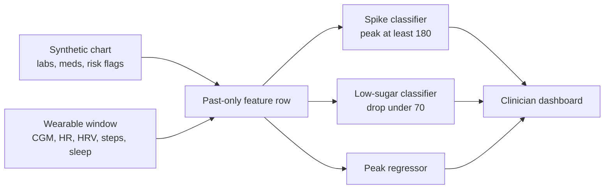

# HealthTwin

**HealthTwin — An AI-Powered Healthcare Digital Twin for Predictive and Personalized Risk Monitoring**

See the change. Understand the risk. Explore what comes next.

This proof of concept is a Type 2 diabetes twin for working-age adults. It joins a synthetic clinic chart with a synthetic wearable stream and estimates whether glucose will peak at or above **180 mg/dL in the next two hours**, or fall to **70 mg/dL** or below.

The doctor uses the dashboard. The patient is who benefits. A hospital or primary-care network is the buyer in the value case.

Built for the Happiest Health Digital Twin Challenge 2026. The published challenge window runs through **20 November 2026**. Submit the public repository on the form before the cut-off shown there. Every row is generated. This is a decision-support prototype, not a medical device, and the alert is not a diagnosis.

## Team details and college / incubator

| | |
|---|---|
| Team name | Ritik Awachat |
| College / incubator | Vijay Patil School of Management |
| Team leader | Ritik Awachat |
| Other members | Solo entry. One full-time student. |
| Folder name for upload | `Ritik Awachat_Vijay Patil School of Management` |

Put the leader's phone number and email on the submission platform only. The public repository should not carry them.

## Project title

**HealthTwin — An AI-Powered Healthcare Digital Twin for Predictive and Personalized Risk Monitoring**

## Problem statement and healthcare use case

India has on the order of 101 million people with diabetes and 136 million with prediabetes, and combined control of sugar, blood pressure, and cholesterol is uncommon. Care is episodic. Glucose spikes, hypoglycemia, and silent cardiovascular strain show up between visits, and the intervention often comes after an emergency. The people with the thinnest monitoring are working-age adults, roughly 30 to 55, who already carry diabetes or prediabetes plus hypertension or another cardiovascular risk factor. Those burden figures come from different studies and should be cited in the final write-up rather than treated as one survey.

HealthTwin is one condition, as the brief requires. Hypertension and cardiovascular risk are on the chart and in the argument. They are not a heart-attack prediction.

> Will this person's glucose reach 180 mg/dL, or fall to 70 mg/dL, at any point in the next two hours?

Two hours is long enough for a walk, a delayed meal, or a message from the clinic, and short enough to check against the sensor. The interesting case is a reading that is still in range. On the held-out demo moment, **Reyansh Joshi (GT-140)**, 47, in Mumbai, has Type 2 diabetes, HbA1c 7.8%, and blood pressure 145 mmHg. At 08:00 on 9 September 2026 his glucose is **117 mg/dL**. The twin puts the spike probability at **96%**. The later peak is **268 mg/dL**.

The same screen ranks the ward, explains the call in sentences, and re-scores the moment if the doctor tries extra steps, a longer night of sleep, or a later meal.

## Technical stack

| Piece | Choice |
|---|---|
| Language | Python 3.11+ (tested on 3.14) |
| Charts and series | pandas, numpy |
| Models | scikit-learn `HistGradientBoostingClassifier` and `HistGradientBoostingRegressor` |
| Dashboard | Streamlit, Plotly |
| Decks | python-pptx |
| Licence | MIT |

### How the two streams are fused

**Static chart (synthetic EHR):** age, sex, BMI, HbA1c, fasting glucose, years with diabetes, metformin, insulin, SGLT2, blood pressure, LDL, eGFR, family history, and simulated TCF7L2 and KCNJ11 allele counts.

**Wearable window (past only, 15-minute steps):** current glucose, 30-minute change, one-hour mean, two-hour variability, six-hour min and max, one-hour heart rate, six-hour HRV, steps over 2 hours and 24 hours, previous completed night of sleep (hours and deep minutes), and time of day.

**Label (future only):** the highest CGM value in the next eight steps (two hours). The row is positive when that peak is at least 180 mg/dL.

The main test is a **patient-level** split, 70% train / 15% validation / 15% test. No person appears in more than one part. The alert threshold maximises F1 on the validation patients and is then frozen. A second check trains on days 1–8 and scores days 10–12, with the two-hour label kept off the cut. That later-week check can see the same people again, so it answers a different question from the unseen-patient test.

A second booster, trained on the same fused inputs, predicts the two-hour peak. The dashboard draws a sketch toward that peak. It is not a full physiological simulation.

The CGM-only baseline is the same classifier trained only on glucose level, recent change, one-hour mean, and two-hour variability. ROC-AUC is the comparison. Each model has its own validation threshold for precision and recall.

### Results on held-out patients

Seed `2026`. 150 virtual patients, ages 30 to 55, 12 days each. About one in five has prediabetes. Most also have hypertension or another cardiovascular risk flag. 23 test patients. About **24%** of moments are positive for a spike.

| | Fusion twin | CGM only |
|---|---:|---:|
| ROC-AUC, unseen patients | **0.918** | 0.828 |
| ROC-AUC when current glucose is still under 140 | **0.873** | 0.670 |
| ROC-AUC, later days of the same cohort | **0.923** | — |
| Average precision | 0.807 | — |
| Precision / recall at its own validation threshold | 0.66 / 0.74 | — |
| Mean absolute error of the predicted peak | 16.6 mg/dL | — |

The in-range slice is the claim. Current glucose has not crossed 140, so a sensor-only model has little to go on. Time of day, the recent step count, and HbA1c carry a large part of the remaining signal, because meals in this generator follow a day and the size of the spike follows the chart and the previous day of sleep and activity. Shuffling time of day hurts the score most, then current glucose, the 30-minute slope, recent steps, and HbA1c.

On that in-range slice the frozen threshold catches about half of the true spikes (`lead_time_recall_fusion` in `models/metrics.json`). A clinic that wanted fewer missed spikes would lower the threshold and accept more false alarms. The demo moment is above the threshold: glucose 117 mg/dL, probability 0.96, predicted peak about 217 mg/dL, later peak 268 mg/dL.

On that same moment, adding 3,000 steps moves the spike probability from 96% to about 87%. Delaying the meal feature by 90 minutes moves it to about 80%. Those are re-scores of the model inputs, not a new glucose simulation.

## Run it

From this folder, in PowerShell:

```powershell
python -m pip install -r requirements.txt
streamlit run app/dashboard.py
```

The cohort, the fitted models, and the decks are already in `data/`, `models/`, and `docs/`. Open the app. Do not retrain for a review. `python -m src.train` rebuilds the cohort and the models. `python -m src.make_presentation` rebuilds the decks. The dashboard trains once on startup only if those model files are missing.

The app opens on the clinic list for Wednesday 9 September 2026, 08:00, titled **Who should get a message?** Reyansh Joshi is first: sugar about 117 mg/dL, a 96% chance it passes 180. **Step 2: open Reyansh Joshi** opens his page. **Walk 30 min** moves that to about 87% and the peak from 217 to 201. **Meal 90 min later** moves it to about 80%. **Reset** restores the original warning. The green line is sugar so far. Orange is the estimate. **Demo only: show what really happened** draws the later reading, which reaches about 268. **Open a quiet example** opens Aarav Joshi at 01:00, when the meal what-if is hidden.

```powershell
python -m unittest tests.test_features -v
```

## Data sandbox

No real patient record is used. The generator is in `src/synthesize.py`.

- The chart is a Synthea-style registry: Indian cities, Type 2 diabetes, labs and medicines that move together (higher HbA1c, more insulin, higher fasting glucose).
- The wearable series mimics a consumer CGM and watch: glucose, heart rate, RMSSD, step counts, and sleep stage. Meal size depends on HbA1c, medicines, the previous night's sleep, recent steps, and a stress day. Meal clock time is noisy, so the hour is a clue rather than a schedule.
- Genetic fields are simulated allele counts for storytelling. They are not a genotype report.
- Replace the generator later with Synthea, MIMIC-IV, or an open wearable set if the rules of that dataset allow it. Keep the patient-level split.

## Architecture



The same picture is in [docs/HealthTwin_Architecture.pptx](docs/HealthTwin_Architecture.pptx) and [docs/HealthTwin_Architecture.pdf](docs/HealthTwin_Architecture.pdf). The jury walkthrough is [docs/HealthTwin_Presentation.pptx](docs/HealthTwin_Presentation.pptx). Rebuild the decks with `python -m src.make_presentation`.

## Video

The challenge asks for a walkthrough of at least 20 minutes, as a recorded slide presentation or an unlisted YouTube link. A timed script that follows this prototype is in [docs/VIDEO_SCRIPT.md](docs/VIDEO_SCRIPT.md).

**Unlisted YouTube URL:** https://www.youtube.com/watch?v=at_H3qICuQU

## Open-source licence

[MIT](LICENSE). You can use, modify, and share this prototype. There is no warranty. It is not cleared for clinical use.

## What is in the repository

| Path | What it is |
|---|---|
| `src/synthesize.py` | Synthetic chart and wearable generator |
| `src/features.py` | Fusion features and the two-hour label |
| `src/train.py` | Patient-level training, baseline, metrics |
| `src/explain.py` | Sentences shown next to the score |
| `src/view.py` | Data behind the dashboard |
| `app/dashboard.py` | Clinician UI |
| `data/` | Generated cohort, scored test moments, demo bookmark |
| `models/` | Fitted models, metrics, permutation importance |
| `docs/` | Architecture deck, presentation, video script |
| `tests/test_features.py` | Label looks forward; the 30-minute delta does not |

## Limits, said on purpose

- A strong score on this generator is not evidence the twin is ready for a ward. The meals, sleep, and spikes were written by us.
- Time of day is informative because people eat on a rhythm. A deployed system should add logged or detected meals instead of leaning on the clock.
- The peak sketch is a smooth path toward one predicted maximum.
- Simulated genetic flags must never be read as a lab result.
- Before any real use: prospective data, calibration, a clinician in the loop, and the regulatory path that applies.

## Submission checklist

Paste on the form, and nowhere else: leader name **Ritik Awachat**, phone, email, and the public GitHub link. The folder name for an upload is `Ritik Awachat_Vijay Patil School of Management`.

- [x] Team name, college, and member names filled in above
- [ ] Leader phone, email, and the public GitHub URL entered on the platform
- [ ] Repository created and set to public, including `data/`, `models/`, and `docs/`
- [x] Video recorded from the script and the unlisted URL pasted above
- [ ] `docs/HealthTwin_Architecture.pdf`, `docs/HealthTwin_Architecture.pptx`, and `docs/HealthTwin_Presentation.pptx` opened once on another computer
